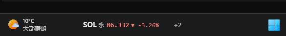
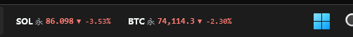

<p align="center">
  
</p>

<h1 align="center">MenuBar CryptoPrice</h1>

<p align="center">A Windows 11 taskbar cryptocurrency ticker</p>

<p align="center">
  
  
  
  
  
  <a href="https://github.com/BeyondESH/MenuBar-CryptoPrice/releases/latest">
    
  </a>
</p>

MenuBar CryptoPrice is a lightweight cryptocurrency ticker that lives in the Windows 11 taskbar. It shows live prices and 24h changes for Bitget spot (SPOT) and USDT-margined perpetual futures (USDT-FUTURES), with a native WinUI 3 settings client, hover details, click-to-expand popups, a `+N` overflow list, and optional auto-start.

> Market data is for reference only and is not investment advice. This project is not affiliated with Bitget.

<p align="center">
  <a href="README.md">简体中文</a> | <a href="README.en.md">English</a>
</p>

## Screenshots

Cropped taskbar screenshots:

<p align="center">
  
  <br />
  <sub>The taskbar shows the SOL perpetual contract; <code>+2</code> means two more symbols are collapsed.</sub>
</p>

<p align="center">
  
  <br />
  <sub>Expanded view with SOL and BTC perpetual contracts side by side.</sub>
</p>

## Table of Contents

- [Screenshots](#screenshots)
- [Features](#features)
- [UI and interaction](#ui-and-interaction)
- [Architecture](#architecture)
- [Installation](#installation)
- [Usage](#usage)
- [Configuration](#configuration)
- [Data sources and privacy](#data-sources-and-privacy)
- [Building from source](#building-from-source)
- [Tests](#tests)
- [Project structure](#project-structure)
- [Known limitations and FAQ](#known-limitations-and-faq)
- [Contributing](#contributing)
- [Support the author](#support-the-author)
- [License](#license)
- [Third-party components](#third-party-components)
- [Acknowledgements and disclaimer](#acknowledgements-and-disclaimer)
- [Version history](#version-history)

## Features

### Taskbar ticker

- Shows 1–8 configured symbols in the empty area of the primary Windows 11 taskbar, mixing spot and USDT-margined perpetual futures.
- Displays symbol, latest price, and 24h change, using the correct price precision and thousands separators.
- Supports green-up/red-down and red-up/green-down color schemes.
- Real-time WebSocket prices with REST first-load and fallback; data older than 30 seconds is dimmed.
- Single-line and compact two-line layouts, four font sizes, and two positions: inside the taskbar or floating above it.
- Left/right anchoring; when space runs out, trailing items collapse into `+N`, and hovering `+N` reveals the full list.
- The taskbar strip uses `WS_EX_NOACTIVATE`, so clicking it does not steal focus.
- Hides itself for fullscreen apps, the Start menu, Search, Task View, and auto-hidden taskbars.
- Handles virtual desktop switches and runs as a single instance; launching it again activates the existing instance.

### Hover and expand

- Hover over a price to see full details: last price, 24h change, 24h high/low, 24h quote volume, best bid/ask, funding rate, mark price, and update time.
- Hover over `+N` to see every configured symbol with visible/waiting/overflow state.
- Click a price or `+N` to open a persistent detail popup.
- Click the desktop, another app, or the empty taskbar to close the popup; clicks inside keep it open.
- The popup also closes when the ticker window is hidden or loses focus.

### Native WinUI 3 settings client

- Windows Settings-style left `NavigationView`: Market (行情), Appearance (外观), About (关于).
- Uses `SettingsCard`, native `ComboBox`, `ToggleSwitch`, `Button`, and `ContentDialog`.
- Market page: visible count, symbol order, market switch, live price, delete, add symbol, refresh catalog.
- Add symbol dialog: market selection, keyword search, "include non-USDT pairs" toggle, online/duplicate validation.
- Appearance page: layout, font size, up/down colors, position, anchor, auto-start, restore defaults.
- About page: author BeyondESH, GitHub profile, project URL, version, data source, config path, open-source components, tip button and QR image.

### Installer and system integration

- Inno Setup installer; per-user installation without administrator rights.
- Default install directory: `%LOCALAPPDATA%\Programs\MenuBarCryptoPrice`.
- Start menu shortcuts for the app, settings, and uninstall; optional desktop shortcut.
- Uninstall stops the host and settings processes and removes the install directory, shortcuts, uninstall entry, and auto-start value.
- User configuration remains in `%APPDATA%\MenuBarCryptoPrice` and is not deleted by uninstall.

## UI and interaction

### Tray menu

| Item | Description |
| --- | --- |
| Settings… | Open the WinUI 3 settings client |
| Reposition | Recalculate the taskbar placement and width immediately |
| Start with Windows | Toggle auto-start for the current user |
| About | Open the About page in the settings client |
| Exit | Quit the host and remove the tray icon |

Double-clicking the tray icon also opens settings.

### Taskbar

| Action | Result |
| --- | --- |
| Hover a price | Show full market details |
| Hover `+N` | Show every configured symbol |
| Click a price/`+N` | Open a persistent popup |
| Click elsewhere | Close the popup |
| Not enough taskbar space | Hide trailing items and show `+N` |

### Settings pages

| Page | Contents |
| --- | --- |
| Market | Visible count, symbol list, market, price, sorting, delete, add symbol, catalog refresh |
| Appearance | Layout, font size, up/down colors, position, anchor, auto-start, restore defaults |
| About | Author, GitHub, project URL, tip, version, data source, config path, open-source components |

On first run without a configuration file, the host opens the settings client automatically.

## Architecture

```text
┌─────────────────────────────────────────────────────────────┐
│ WPF host (MenuBarCryptoPrice.exe)                           │
│                                                             │
│  Bitget REST / WebSocket ──▶ TickerStore ──▶ TickerWindow   │
│                                      │        (taskbar)     │
│                                      │                       │
│  Tray / auto-start / single instance / virtual desktop /     │
│  taskbar geometry                                            │
└───────────────────────────┬─────────────────────────────────┘
                            │ shared config.json
                            │ %APPDATA%\MenuBarCryptoPrice
┌───────────────────────────┴─────────────────────────────────┐
│ WinUI 3 settings client                                     │
│ (MenuBarCryptoPrice.Settings.WinUI.exe)                     │
│                                                             │
│  NavigationView + SettingsCard                              │
│  Market / Appearance / About                                │
└─────────────────────────────────────────────────────────────┘
```

### Why two processes

The taskbar overlay needs a per-pixel transparent, non-activating, topmost, hit-testable window. WPF handles this well; WinUI 3 is not suitable for that kind of taskbar overlay. The settings client needs genuine Windows 11 controls (NavigationView, SettingsCard, Mica, system accent colors), so it is a separate WinUI 3 process.

Both processes share `config.json`: after the settings client saves, the host watches the file with `FileSystemWatcher`, debounces for 300–700 ms, then re-layouts the taskbar strip and re-subscribes to market data when needed.

## Installation

### Requirements

- Windows 11 build 22000 or later.
- x64 processor.
- The installer is self-contained and includes the .NET 8 runtime and Windows App SDK; no separate .NET or Windows App Runtime installation is required.

### Steps

1. Open [Releases](https://github.com/BeyondESH/MenuBar-CryptoPrice/releases/latest).
2. Download `MenuBarCryptoPrice-Setup-1.0.1.exe`.
3. Run the installer. It installs for the current user and does not trigger UAC.
4. Optionally enable the desktop shortcut.
5. Optionally launch the app after installation; the first run opens settings automatically.

The installer is not code-signed, so Windows SmartScreen may show "Windows protected your PC". If you trust the download, choose "More info" and then "Run anyway".

### Upgrade

Run the new installer over the existing installation; no uninstall is required. User configuration and auto-start settings are preserved. If the installer reports that the app is running, exit it from the tray menu first.

### Uninstall

Use Windows Settings → Apps → Installed apps → MenuBar CryptoPrice, or the Start menu uninstall shortcut.

Uninstall removes the install directory, Start menu shortcuts, uninstall registry entry, and auto-start value. It preserves the user configuration in `%APPDATA%\MenuBarCryptoPrice`. Delete that directory manually to start completely fresh.

## Usage

### First run

1. Start `MenuBarCryptoPrice.exe`.
2. The ticker appears in the taskbar and a tray icon is created.
3. On first run without a config file, the settings client opens automatically.
4. Add symbols and adjust their order on the Market page.
5. Choose layout, font size, colors, position, and anchor on the Appearance page.
6. Close the settings window; changes are already applied.

### Add a symbol

1. Settings → Market → Add symbol.
2. Choose Spot or USDT-margined perpetual.
3. Enter a keyword such as `BTC` or `ETH`, or enable "Include non-USDT pairs".
4. Select a pair from the results and click Add.
5. The same pair can be added once per market; spot and perpetual can coexist.

### Display settings

- "Visible count" controls how many items the taskbar shows at most; extra items collapse into `+N`.
- Use the up/down buttons to reorder and the delete button to remove an item.
- The market dropdown on each row switches between spot and perpetual and applies the corresponding precision.
- The Appearance page's "Anchor" chooses whether the strip prefers empty space on the left or right of the taskbar.
- If space is tight, reduce the count, switch to the compact two-line layout, or choose "Above taskbar".

### Auto-start

Toggle it from the tray menu or the Appearance page. The app writes a startup entry under `HKCU\Software\Microsoft\Windows\CurrentVersion\Run` and starts silently with the `--autostart` argument.

### About and tips

Settings → About contains:

- Author BeyondESH and GitHub profile: <https://github.com/BeyondESH>
- Project URL: <https://github.com/BeyondESH/MenuBar-CryptoPrice>
- Version, data source, config file path, and open-source components.
- A "View tip QR" button that opens `dashang.jpg`.

## Configuration

Configuration file:

```text
%APPDATA%\MenuBarCryptoPrice\config.json
```

Example:

```json
{
  "version": 2,
  "maxVisibleItems": 4,
  "layout": "singleLine",
  "fontSize": "medium",
  "colorScheme": "greenUp",
  "positionMode": "taskbar",
  "anchor": "left",
  "startWithWindows": true,
  "offsetX": 0,
  "items": [
    { "market": "USDT-FUTURES", "symbol": "SOLUSDT", "precision": 3 },
    { "market": "USDT-FUTURES", "symbol": "BTCUSDT", "precision": 1 },
    { "market": "USDT-FUTURES", "symbol": "ETHUSDT", "precision": 2 }
  ]
}
```

| Field | Type | Default | Description |
| --- | --- | --- | --- |
| `version` | int | `2` | Configuration version used for migration |
| `maxVisibleItems` | int | `4` | Maximum visible items, 1–8 |
| `layout` | string | `singleLine` | `singleLine` / `compactTwoLine` |
| `fontSize` | string | `medium` | `small` / `medium` / `large` / `extraLarge` |
| `colorScheme` | string | `greenUp` | `greenUp` / `redUp` |
| `positionMode` | string | `taskbar` | `taskbar` / `aboveTaskbar` |
| `anchor` | string | `right` | `right` / `left` |
| `startWithWindows` | bool | `false` | Write the current-user startup entry |
| `offsetX` | int | `0` | Manual horizontal offset, -4000–4000 |
| `items` | array | — | Configured symbols |
| `items[].market` | string | `SPOT` | `SPOT` / `USDT-FUTURES` |
| `items[].symbol` | string | — | Pair such as `BTCUSDT` |
| `items[].precision` | int | — | Price decimals, 0–8 |

Configuration is written via a temporary file and an atomic replace. Corrupt files are backed up as `config.json.bak` and defaults are restored. Version migration runs automatically on upgrade.

Other directories:

```text
%APPDATA%\MenuBarCryptoPrice\cache\   Symbol catalog cache (24h TTL)
%APPDATA%\MenuBarCryptoPrice\logs\    Runtime logs
```

## Data sources and privacy

Market data comes from Bitget public endpoints:

- WebSocket: `wss://ws.bitget.com/v2/ws/public`, channel `ticker`, subscribing to both `SPOT` and `USDT-FUTURES`.
- Spot REST: `/api/v2/spot/market/tickers?symbol=...`
- Futures REST: `/api/v2/mix/market/ticker?symbol=...&productType=USDT-FUTURES`
- Symbol catalogs: `/api/v2/spot/public/symbols` and `/api/v2/mix/market/contracts?productType=USDT-FUTURES`

The app does not require an API key and does not access accounts, positions, or trading endpoints.

Privacy:

- No configuration, watchlist, or usage data is uploaded.
- No telemetry, analytics, or advertising SDKs.
- Network requests go only to Bitget public market-data endpoints.
- Configuration, cache, and logs stay locally under `%APPDATA%\MenuBarCryptoPrice`.

## Building from source

### Environment

- Windows 11 x64.
- .NET SDK 8.0 or later.
- Git.
- Inno Setup 6 to build the installer.

Install Inno Setup 6:

```powershell
winget install --id JRSoftware.InnoSetup -e --source winget
```

### Build

```powershell
git clone https://github.com/BeyondESH/MenuBar-CryptoPrice.git
cd MenuBar-CryptoPrice
dotnet build MenuBarCryptoPrice.slnx
```

The solution contains:

- `src/MenuBarCryptoPrice`: WPF host.
- `src/MenuBarCryptoPrice.Settings.WinUI`: WinUI 3 settings client.
- `tests/MenuBarCryptoPrice.Tests`: xUnit tests.

### Run locally

```powershell
dotnet run --project src/MenuBarCryptoPrice/MenuBarCryptoPrice.csproj
```

The host searches for the settings client in its debug output directory; build the WinUI project too on a fresh checkout. You can also start it directly:

```powershell
src\MenuBarCryptoPrice\bin\Debug\net8.0-windows\win-x64\MenuBarCryptoPrice.exe
```

### Publish

```powershell
.\scripts\publish.ps1
```

Output:

```text
dist\
  MenuBarCryptoPrice.exe
  settings\
    MenuBarCryptoPrice.Settings.WinUI.exe
    Assets\
    ...
```

The host is a self-contained single file. The WinUI settings client is a self-contained directory; XAML resources, `Assets`, and runtime files must be published together.

### Build the installer

```powershell
.\scripts\build-installer.ps1
```

The script runs `scripts\publish.ps1` and then invokes Inno Setup:

```text
dist\MenuBarCryptoPrice-Setup-1.0.1.exe
```

If `dist` is already current, skip publishing:

```powershell
.\scripts\build-installer.ps1 -SkipPublish
```

The installer script is `installer\MenuBarCryptoPrice.iss`; the Simplified Chinese language file is `installer\ChineseSimplified.isl`.

## Tests

```powershell
dotnet test tests/MenuBarCryptoPrice.Tests/MenuBarCryptoPrice.Tests.csproj
```

There are currently 61 tests covering:

- Configuration load/migration/corruption recovery/round-trip.
- Bitget frame parsing and formatting edge cases.
- Reconnect backoff and data freshness.
- Taskbar visibility policy and geometry.
- Taskbar strip overflow, tooltips, and popup state.
- Symbol catalog parsing and caching.
- Market/pair deduplication and precision.

Manual checks:

- Left/right anchor at 100%/125%/150% DPI.
- Fullscreen apps, Start menu, Search, and Task View.
- Hover details, `+N` list, and outside-click close.
- Settings changes applying to the taskbar immediately.
- Install/upgrade/uninstall and auto-start cleanup.

## Project structure

```text
MenuBar-CryptoPrice/
├─ src/
│  ├─ MenuBarCryptoPrice/                     WPF host
│  │  ├─ Core/                                Configuration, markets, symbols
│  │  ├─ MarketData/                          REST/WS, catalogs, parsing, formatting
│  │  ├─ Taskbar/                             Placement, overlay window, visibility, virtual desktops
│  │  ├─ Controls/                            Taskbar strip, popups, interaction
│  │  ├─ Infrastructure/                      Configuration, logging, tray, auto-start, single instance
│  │  ├─ Assets/app.ico
│  │  └─ refs/                                UIAutomation reference assemblies
│  └─ MenuBarCryptoPrice.Settings.WinUI/      WinUI 3 settings client
│     ├─ Pages/                               Market / Appearance / About
│     ├─ ViewModels/
│     ├─ Dialogs/                             Add symbol
│     ├─ Assets/                              app.ico / dashang.jpg
│     └─ MenuBarCryptoPrice.Settings.WinUI.csproj
├─ tests/MenuBarCryptoPrice.Tests/            xUnit tests
├─ installer/                                 Inno Setup script and Chinese language file
├─ scripts/                                   publish.ps1 / build-installer.ps1
├─ docs/icon.png                              README icon
├─ docs/xiaoguo1.png                          Taskbar screenshot
├─ docs/xiaoguo2.png                          Multi-symbol taskbar screenshot
├─ LICENSE                                    GPL-3.0
├─ README.md                                  Simplified Chinese README
├─ README.en.md                               English README
└─ CHANGELOG.md
```

## Known limitations and FAQ

### Which Windows versions are supported?

Windows 11 x64 (22000+). The taskbar overlay relies on the Windows 11 `Shell_TrayWnd` and taskbar layout. Windows 10 and early Windows 11 builds are not validated.

### Is the secondary taskbar supported?

The current version primarily supports the primary taskbar. The secondary `Shell_SecondaryTrayWnd` is outside the v1 acceptance scope.

### The ticker is missing or positioned incorrectly

- Tray menu → Reposition.
- Toggle the anchor or visible count on the Appearance page.
- Check whether the taskbar is auto-hidden, or whether a fullscreen app, Start menu, or Task View is active.
- On multi-monitor or high-DPI setups, fine-tune `offsetX` in the configuration.
- Check the placement log under `%APPDATA%\MenuBarCryptoPrice\logs`.

### Why does the settings window reappear after minimizing?

Fixed in 1.0.1. Previously a startup visibility guard restored any minimized window for eight seconds, so a user minimize looked like a crash and reappearance. The guard now stops after the first activation; upgrade older versions to 1.0.1.

### Data is not updating or shows "stale"

- Check whether the network, proxy, or firewall blocks `api.bitget.com` and `ws.bitget.com`.
- The app falls back to REST polling when WebSocket is unavailable; prices older than 30 seconds are dimmed.
- Check the WebSocket/REST errors in the logs.

### The configuration is corrupt

The app backs up a corrupt file as `config.json.bak` and falls back to defaults. You can also close the app and delete `%APPDATA%\MenuBarCryptoPrice\config.json`; it will be recreated on the next start.

### Why does the installer show an unknown publisher?

The installer is not signed with a code-signing certificate. SmartScreen may warn about an unknown publisher. If you downloaded it from this repository's Releases, choose "More info" → "Run anyway". Future versions may be signed if a certificate is available.

### Why is the app not installed in Program Files?

The installer performs a per-user installation under `%LOCALAPPDATA%\Programs`, so it does not require administrator rights or trigger UAC. The app serves the current user; configuration and auto-start are stored in HKCU.

### Does uninstall delete my configuration?

No. Uninstall preserves `%APPDATA%\MenuBarCryptoPrice`. Delete that directory manually for a full reset.

## Contributing

Issues and pull requests are welcome:

1. Fork the repository.
2. Create a branch: `git checkout -b feature/your-feature`.
3. Make changes and run `dotnet build MenuBarCryptoPrice.slnx` and `dotnet test`.
4. Open a pull request describing the purpose, verification, and screenshots if applicable.
5. Do not commit API keys, personal configuration, logs, or build artifacts.

The project is licensed under GPL-3.0-or-later; contributions are accepted under the same license.

## Support the author

If this tool is useful, please consider starring the repository or using "About → View tip QR" in the client. Tips are entirely optional.

<p align="center">
  
</p>

## License

This project is licensed under the **GNU General Public License v3.0 or later (GPL-3.0-or-later)**.

```text
Copyright (C) 2026 BeyondESH

This program is free software: you can redistribute it and/or modify
it under the terms of the GNU General Public License as published by
the Free Software Foundation, either version 3 of the License, or
(at your option) any later version.

This program is distributed in the hope that it will be useful,
but WITHOUT ANY WARRANTY; without even the implied warranty of
MERCHANTABILITY or FITNESS FOR A PARTICULAR PURPOSE.  See the
GNU General Public License for more details.
```

See [LICENSE](LICENSE) for the full license text. If you distribute binaries, comply with the GPL source-availability requirements.

## Third-party components

- .NET / WPF: MIT License.
- Windows App SDK / WinUI 3: MIT License.
- CommunityToolkit.Mvvm: MIT License.
- CommunityToolkit.WinUI.Controls.SettingsControls: MIT License.
- Inno Setup: Inno Setup License.
- UIAutomation reference assemblies: Microsoft Windows SDK components.
- Bitget public market-data API: provided by Bitget; this project is not affiliated with Bitget.

All component copyrights belong to their respective authors.

## Acknowledgements and disclaimer

Thanks to Bitget for the public market-data API, and to the .NET, WPF, WinUI 3, CommunityToolkit, and Inno Setup communities.

This project is for learning and personal market display only. It does not provide trading, investment advice, or any promise of profit. Cryptocurrency prices are highly volatile; assess the risks yourself.

## Version history

- **v1.0.1**: Fixed the settings window reappearing after minimize; WinUI 3 settings client, outside-click popup close, GitHub/tip/icon, and installer.
- **v1.0.0**: Initial taskbar overlay, Bitget spot/perpetual data, settings client, and installer.

See [CHANGELOG.md](CHANGELOG.md) for details.
